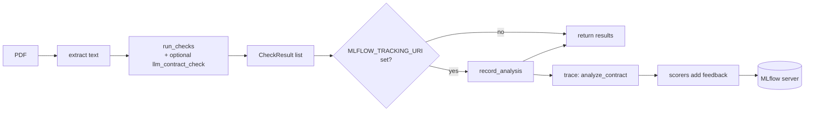

# MLflow Experiment Tracking

This project can record each contract analysis in **MLflow 3.17.2**. Each
analysis is stored as a **trace**, and five **scores** are attached to it.
You can then browse, filter and compare analyses in the MLflow UI.

Tracking is **optional**. If you do not configure it, the app works exactly
as before and nothing is sent anywhere.

## Contents

- [How it works](#how-it-works)
- [Quick start](#quick-start)
- [Configuration](#configuration)
- [What gets logged](#what-gets-logged)
- [Scores](#scores)
- [Offline evaluation](#offline-evaluation)
- [Code layout](#code-layout)
- [Testing](#testing)
- [Testing with the sample documents](#testing-with-the-sample-documents)
- [Finding traces in MLflow](#finding-traces-in-mlflow)
- [Troubleshooting](#troubleshooting)

## How it works



1. The CLI (`uv run main.py ...`) or the API (`POST /analyze`) runs the checks.
2. Both call `record_analysis()` in
   [`src/contract_checker/tracking.py`](../src/contract_checker/tracking.py).
3. If `MLFLOW_TRACKING_URI` is not set, `record_analysis()` returns at once.
4. Otherwise it creates one trace named `analyze_contract` and runs the
   scorers from [`src/contract_checker/scoring.py`](../src/contract_checker/scoring.py).
   Each scorer result is attached to the trace as **feedback**.
5. If anything in MLflow fails (server down, network error, …), a warning is
   logged and the analysis result is returned normally.

## Quick start

### 1. Start the MLflow server

The server is defined in [`docker-compose.yml`](../docker-compose.yml).

```bash
docker compose up -d
docker compose ps        # wait until the status shows "healthy"
```

Open the UI at <http://localhost:5001>.

### 2. Point the app at the server

```bash
export MLFLOW_TRACKING_URI=http://localhost:5001
```

### 3. Run an analysis

Command line:

```bash
uv run main.py documents/contract.pdf
uv run main.py --llm documents/contract.pdf    # also logs llm_score
```

When tracking succeeds, the CLI prints the trace id to stderr:

```
Logged to MLflow (trace tr-...).
```

Web UI:

```bash
uv run ui.py
```

Every click on **Scan & Analyse** creates one trace.

### 4. Look at the results

In the MLflow UI, open the **contract-checker** experiment and go to the
**Traces** tab. Click a trace to see its inputs, outputs and the five scores.

### 5. Stop the server

```bash
docker compose down        # keeps stored traces
docker compose down -v     # also deletes the mlflow-data volume
```

## Configuration

### Application (environment variables)

| Variable                    | Default            | Purpose                                                        |
|-----------------------------|--------------------|----------------------------------------------------------------|
| `MLFLOW_TRACKING_URI`       | *(unset)*          | Turns tracking on. Example: `http://localhost:5001`            |
| `MLFLOW_EXPERIMENT_NAME`    | `contract-checker` | Experiment that receives the traces                            |
| `MLFLOW_DISABLE_AGENT_HINT` | *(unset)*          | Set to `1` to hide an info message MLflow prints on import     |

### Docker server

| Setting          | Value                                      |
|------------------|--------------------------------------------|
| Image            | `ghcr.io/mlflow/mlflow:v3.17.2`            |
| Container port   | `5008`                                     |
| Host port        | `127.0.0.1:${MLFLOW_PORT:-5001}`           |
| Metadata store   | SQLite at `/mlflow/mlflow.db`              |
| Artifact store   | `/mlflow/artifacts`                        |
| Volume           | `mlflow-data` mounted at `/mlflow`         |
| Health check     | `GET http://localhost:5008/health`         |

Notes:

- The port is bound to `127.0.0.1`, so only your own machine can reach it.
- The host port defaults to `5001` because macOS AirPlay uses `5000`.
- To use another host port, set `MLFLOW_PORT` **and** update
  `MLFLOW_TRACKING_URI` to match:

  ```bash
  MLFLOW_PORT=5050 docker compose up -d
  export MLFLOW_TRACKING_URI=http://localhost:5050
  ```

## What gets logged

Each analysis creates one trace with a single span.

| Field        | Value                                                                  |
|--------------|------------------------------------------------------------------------|
| Experiment   | `MLFLOW_EXPERIMENT_NAME` or `contract-checker`                         |
| Span name    | `analyze_contract`                                                     |
| Span type    | `CHAIN`                                                                |
| Inputs       | `source` and `word_count`                                              |
| Outputs      | `checks`: one entry per check with `name`, `passed`, `message`, `score` |
| Feedback     | One entry per scorer (see [Scores](#scores))                           |
| Feedback source | type `CODE`, id `contract_checker.scoring`                          |

`source` is:

- **CLI:** the PDF path exactly as you typed it on the command line.
- **API:** the uploaded file name, or `contract.pdf` if it has none.

Example outputs payload:

```json
{
  "checks": [
    {"name": "section", "passed": true,  "message": "Required section(s) found.", "score": null},
    {"name": "section", "passed": true,  "message": "Required section(s) found.", "score": null},
    {"name": "section", "passed": true,  "message": "Required section(s) found.", "score": null},
    {"name": "length",  "passed": true,  "message": "Contract length: 120 words (minimum 50).", "score": null},
    {"name": "llm",     "passed": true,  "message": "Nimble contract-plausibility score 0.60 (threshold 0.50).", "score": 0.6}
  ]
}
```

### Privacy

The **contract text is never logged**. Only the source name, the word count
and the check results leave the application.

Keep in mind that the CLI logs the path you pass in. If file or folder names
contain sensitive information, run the CLI from the folder that holds the PDF
and pass only the file name.

## Scores

All scorers use MLflow's `@scorer` decorator and return a `Feedback` with a
value and a short rationale. The decision threshold is
`DECISION_THRESHOLD = 0.5`.

| Scorer            | Type  | How it is calculated                                                                 |
|-------------------|-------|--------------------------------------------------------------------------------------|
| `heuristic_score` | 0–1   | Passed heuristic checks ÷ all heuristic checks (the `llm` check is ignored)          |
| `llm_score`       | 0–1   | Score returned by the Nimble model. Only logged when the LLM check ran               |
| `contract_score`  | 0–1   | `heuristic_score` if no LLM score, otherwise `(heuristic_score + llm_score) / 2`     |
| `confidence`      | 0–1   | `abs(contract_score − 0.5) / 0.5`, capped at 1                                       |
| `is_contract`     | bool  | `contract_score >= 0.5`                                                              |

### How to read `confidence`

`confidence` shows how clear the verdict is, not whether it is correct.

- `1.0` — `contract_score` is `0.0` or `1.0`. The checks agree completely.
- `0.0` — `contract_score` is exactly `0.5`. The verdict is a coin flip.

### Worked example

Four heuristic checks pass and Nimble returns `0.6`:

| Scorer            | Calculation           | Result |
|-------------------|-----------------------|--------|
| `heuristic_score` | 4 / 4                 | `1.0`  |
| `llm_score`       | from Nimble           | `0.6`  |
| `contract_score`  | (1.0 + 0.6) / 2       | `0.8`  |
| `confidence`      | abs(0.8 − 0.5) / 0.5  | `0.6`  |
| `is_contract`     | 0.8 >= 0.5            | `true` |

### When the LLM check does not run

- During live tracking, `llm_score` is **skipped** (see `applicable_scorers()`).
- When called directly or through `mlflow.genai.evaluate`, `llm_score`
  returns a `Feedback` with the error `LLM check was not run.` instead of a value.

### When the LLM check fails

If Nimble cannot be reached, `llm_contract_check` returns a failed `llm`
check with `score = None`. The scores then behave as if the LLM did not run.

## Offline evaluation

The same scorers work with `mlflow.genai.evaluate`, for example to compare
a batch of saved results. Each row needs `inputs` and `outputs`.

```python
import mlflow

from contract_checker.models import CheckResult
from contract_checker.scoring import ALL_SCORERS, analysis_outputs

data = [
    {
        "inputs": {"source": "a.pdf", "word_count": 120},
        "outputs": analysis_outputs([
            CheckResult("section", True, "ok"),
            CheckResult("length", True, "ok"),
            CheckResult("llm", True, "x", score=0.6),
        ]),
    },
    {
        "inputs": {"source": "b.pdf", "word_count": 30},
        "outputs": analysis_outputs([
            CheckResult("section", False, "missing"),
            CheckResult("length", True, "ok"),
        ]),
    },
]

mlflow.set_experiment("contract-checker-eval")
result = mlflow.genai.evaluate(data=data, scorers=list(ALL_SCORERS))
print(result.metrics)
```

Run it with `MLFLOW_TRACKING_URI` set. For the data above the metrics are:

```text
heuristic_score/mean  0.75
llm_score/mean        0.6     # only row 1 has an LLM score
contract_score/mean   0.65
confidence/mean       0.3
is_contract/mean      1.0
```

## Code layout

| File                                                                          | Responsibility                                                             |
|-------------------------------------------------------------------------------|----------------------------------------------------------------------------|
| [`src/contract_checker/scoring.py`](../src/contract_checker/scoring.py)       | `@scorer` functions, `analysis_outputs()`, `applicable_scorers()`           |
| [`src/contract_checker/tracking.py`](../src/contract_checker/tracking.py)     | `is_enabled()`, `record_analysis()`; creates the trace and logs feedback   |
| [`src/contract_checker/models.py`](../src/contract_checker/models.py)         | `CheckResult` with optional `score` field                                  |
| [`src/contract_checker/checks.py`](../src/contract_checker/checks.py)         | `llm_contract_check()` fills `score` with the Nimble value                 |
| [`src/contract_checker/api.py`](../src/contract_checker/api.py)               | Calls `record_analysis()` in a thread pool after each `/analyze` request   |
| [`src/contract_checker/main.py`](../src/contract_checker/main.py)             | Calls `record_analysis()` and prints the trace id                         |
| [`docker-compose.yml`](../docker-compose.yml)                                 | Local MLflow server                                                        |

### Adding a new scorer

1. Add a function decorated with `@scorer` in `scoring.py`. It receives
   `outputs` (the dict from `analysis_outputs()`) and returns a `Feedback`.
   Use the `_feedback()` helper so the name and source are set.
2. Add it to `ALL_SCORERS`.
3. If it only makes sense in some cases, filter it in `applicable_scorers()`.
4. Add tests in [`tests/test_scoring.py`](../tests/test_scoring.py).

## Testing

Run all commands from the project root.

```bash
uv run pytest                                   # all tests
uv run pytest -v                                # one line per test
uv run pytest tests/test_scoring.py             # one file
uv run pytest tests/test_sample_orders.py -k pickup          # one sample order
uv run pytest tests/test_scoring.py::test_is_contract_true_at_threshold   # one test
```

| File                                                                  | What it tests                                                                        |
|-----------------------------------------------------------------------|--------------------------------------------------------------------------------------|
| [`tests/test_contract_checker.py`](../tests/test_contract_checker.py) | Text extraction and heuristic checks                                                 |
| [`tests/test_api.py`](../tests/test_api.py)                           | FastAPI `/health` and `/analyze`, including invalid uploads                          |
| [`tests/test_scoring.py`](../tests/test_scoring.py)                   | Scorer formulas, threshold edge case, `llm_score` error, tracking on/off and errors  |
| [`tests/test_sample_orders.py`](../tests/test_sample_orders.py)       | Sample orders against the ground truth (see below)                                   |

`tests/test_sample_orders.py` generates the three sample orders into a
temporary folder and compares page count, extracted fields, totals, check
results, scores and the `/analyze` response with
[`tests/fixtures/sample_orders_ground_truth.json`](../tests/fixtures/sample_orders_ground_truth.json).
The test ids are the file names without `.pdf`, so `-k transporter`,
`-k pickup` or `-k minibus` select one order.

### MLflow during tests

[`tests/conftest.py`](../tests/conftest.py) sets `MLFLOW_TRACKING_URI` for
**every** test to a temporary SQLite database (`sqlite:///<tmp>/mlflow.db`).
This means:

- the tracking code runs in every test, just like in production,
- no Docker server is needed,
- test traces **never** reach your MLflow server and do not show up in the UI,
- the temporary database is deleted after the test run.

The LLM check (`--llm`) needs Ollama and is not part of the test suite.

## Testing with the sample documents

Use this to see real traces for the sample documents in the MLflow UI.

### 1. Generate the sample PDFs

```bash
uv run python scripts/generate_sample_orders.py
```

This writes three synthetic orders with fake data to `documents/samples/`:

- `sample_order_transporter.pdf`
- `sample_order_pickup.pdf`
- `sample_order_minibus.pdf`

The folder is in `.gitignore`. To write somewhere else, pass a folder:
`uv run python scripts/generate_sample_orders.py /tmp/samples`.

### 2. Start MLflow and set the tracking URI

```bash
docker compose up -d
export MLFLOW_TRACKING_URI=http://localhost:5001
```

### 3. Analyse the samples

With the CLI, one trace per file:

```bash
for f in documents/samples/*.pdf; do uv run main.py "$f"; done
```

Each run prints `Logged to MLflow (trace tr-...).` Note the trace ids.

With the API, start the app **in the same shell** (so it sees
`MLFLOW_TRACKING_URI`), then upload a file from a second shell:

```bash
uv run ui.py            # shell 1, backend on http://localhost:8000
```

```bash
curl -s http://localhost:8000/analyze \
  -F "file=@documents/samples/sample_order_pickup.pdf;type=application/pdf" \
  -F use_llm=false
```

The `type=application/pdf` part is required; the API rejects other content
types with `422`. You can also drop the files into the web UI instead.

### 4. Expected scores

Without the LLM check, every sample order should show:

| Scorer            | Value  |
|-------------------|--------|
| `heuristic_score` | `0.75` |
| `contract_score`  | `0.75` |
| `confidence`      | `0.5`  |
| `is_contract`     | `true` |

`heuristic_score` is `0.75` because the `parties` check does not match the
German wording of the samples (3 of 4 checks pass).

## Finding traces in MLflow

### In the MLflow UI

1. Open <http://localhost:5001>.
2. Open **Experiments** and click **contract-checker** (or the name in
   `MLFLOW_EXPERIMENT_NAME`).
3. Open the **Traces** tab. Each row is one analysis; the newest is on top.
   The request column shows the `source` (CLI path or uploaded file name).
4. Click a row to open the trace:
   - the `analyze_contract` span shows **Inputs** (`source`, `word_count`)
     and **Outputs** (the `checks` list),
   - the **Assessments** panel shows the scores (`heuristic_score`,
     `contract_score`, `confidence`, `is_contract`, and `llm_score` when the
     LLM ran), each with its rationale.

If the list is empty, check the [Troubleshooting](#troubleshooting) table.

### From Python

Use the trace id printed by the CLI:

```bash
uv run python - <<'EOF'
import mlflow

mlflow.set_tracking_uri("http://localhost:5001")
trace = mlflow.get_trace("tr-...")            # paste the trace id here
for assessment in trace.info.assessments:
    print(assessment.name, assessment.feedback.value)
EOF
```

To list the latest traces of the experiment:

```bash
uv run python - <<'EOF'
import mlflow

mlflow.set_tracking_uri("http://localhost:5001")
experiment = mlflow.get_experiment_by_name("contract-checker")
traces = mlflow.search_traces(experiment_ids=[experiment.experiment_id], max_results=10)
print(traces["trace_id"].to_string())
EOF
```

## Troubleshooting

| Symptom                                                          | Cause and fix                                                                                                                  |
|------------------------------------------------------------------|--------------------------------------------------------------------------------------------------------------------------------|
| No traces appear in the UI                                       | `MLFLOW_TRACKING_URI` is not set in the shell that runs the app. Export it, then restart `uv run ui.py`.                     |
| Log shows `MLflow tracking failed; analysis result is unaffected.` | The server is not reachable. Check `docker compose ps` and that the URI port matches the host port (default `5001`).        |
| Container stays `unhealthy`                                      | The health check calls port `5008` inside the container. If you change `--port` in `docker-compose.yml`, update the health check too. |
| `llm_score` missing on a trace                                   | The analysis ran without `--llm` / **Use LLM**, or Nimble could not be reached.                                               |
| Traces land in the wrong experiment                              | `MLFLOW_EXPERIMENT_NAME` is set in your shell. Unset it to use `contract-checker`.                                             |
| Port `5000` errors on macOS                                      | AirPlay Receiver uses `5000`. Keep the default `5001` or pick another `MLFLOW_PORT`.                                           |
| CLI prints an `mlflow.agent.hint` info line                      | Informational message from MLflow. Set `MLFLOW_DISABLE_AGENT_HINT=1` to hide it.                                              |
